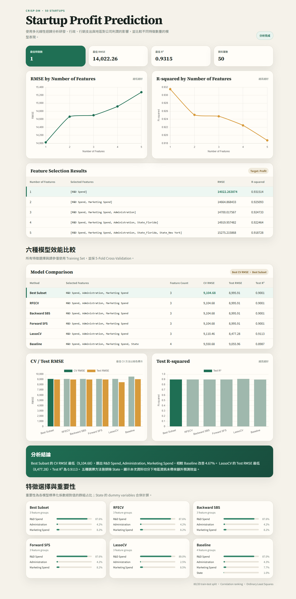
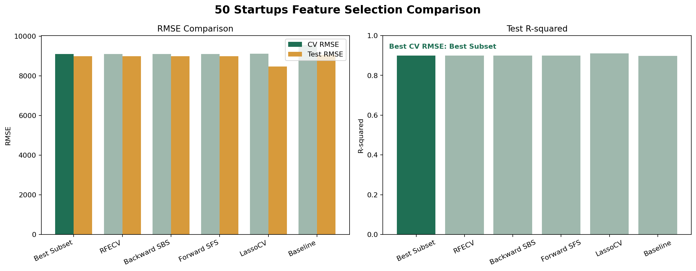

# 50 Startups Multiple Linear Regression

## Demo

**GitHub：** [https://github.com/cotaj6011-coder/AIoT_20261014-1](https://github.com/cotaj6011-coder/AIoT_20261014-1)

**網站：** [https://cotaj6011-coder.github.io/AIoT_20261014-1/](https://cotaj6011-coder.github.io/AIoT_20261014-1/)



## 專案說明

使用 50 Startups Dataset 建立多元線性迴歸模型，根據以下欄位預測公司利潤：

- R&D Spend
- Administration
- Marketing Spend
- State

`State` 使用 One-Hot Encoding，並刪除第一個類別作為基準，避免 dummy variable trap。

網站提供六種模型切換、CV RMSE／CV R² 特徵數量曲線、圖表縮放與篩選、自訂特徵重訓、即時 Profit 預測、迴歸公式、係數、殘差分析及五大迴歸假設檢查。預設模型資料由 Python 實驗輸出；自訂模型沿用固定 Training/Test split，Test Set 僅在訓練完成後評估一次。

## CRISP-DM 流程

1. Business Understanding：預測新創公司的 Profit。
2. Data Understanding：檢查資料欄位、統計摘要及遺漏值。
3. Data Preparation：類別編碼並切分訓練集與測試集。
4. Modeling：使用 scikit-learn `LinearRegression`。
5. Evaluation：以 MAE、RMSE 與 R² 評估模型。
6. Deployment：透過 GitHub Pages 呈現分析圖表與特徵選擇結果。

## Feature Selection 比較

所有特徵選擇與參數調整只使用 Training Set，並採用 5-Fold Cross-Validation。`State` 經過 One-Hot Encoding 後仍視為同一組特徵；LassoCV 額外使用 StandardScaler。

| Method | Selected Features | Count | CV RMSE | Test RMSE | Test R² |
|---|---|---:|---:|---:|---:|
| Best Subset | R&D Spend, Administration, Marketing Spend | 3 | 9,104.68 | 8,995.91 | 0.9001 |
| RFECV | R&D Spend, Administration, Marketing Spend | 3 | 9,104.68 | 8,995.91 | 0.9001 |
| Backward SBS | R&D Spend, Administration, Marketing Spend | 3 | 9,104.68 | 8,995.91 | 0.9001 |
| Forward SFS | R&D Spend, Administration, Marketing Spend | 3 | 9,104.68 | 8,995.91 | 0.9001 |
| LassoCV | R&D Spend, Administration, Marketing Spend | 3 | 9,110.46 | 8,477.28 | 0.9113 |
| Baseline | R&D Spend, Administration, Marketing Spend, State | 4 | 9,550.68 | 9,055.96 | 0.8987 |



依 CV RMSE 判斷，最佳方法為 Best Subset Selection，最佳特徵組合是 `R&D Spend`、`Administration` 與 `Marketing Spend`。四種子集合式方法得到相同結果；LassoCV 的 CV RMSE 略高，但 Test RMSE 最低。Baseline 納入 State 後沒有改善效能，表示本次切分下地區資訊的額外預測貢獻有限。

## 執行方式

安裝套件：

```bash
pip install -r requirement.txt
```

執行模型：

```bash
python startup_regression.py
```

## 專案檔案

```text
50_Startups.csv
startup_regression.py
requirement.txt
model_comparison.csv
model_comparison.png
dic-regression-dashboard/
└── dist/
    ├── index.html
    └── app.js
```
